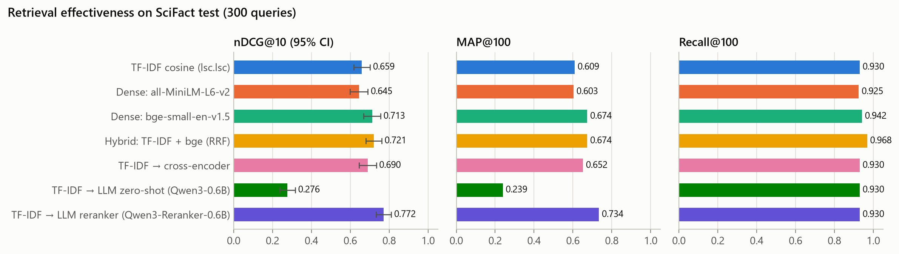
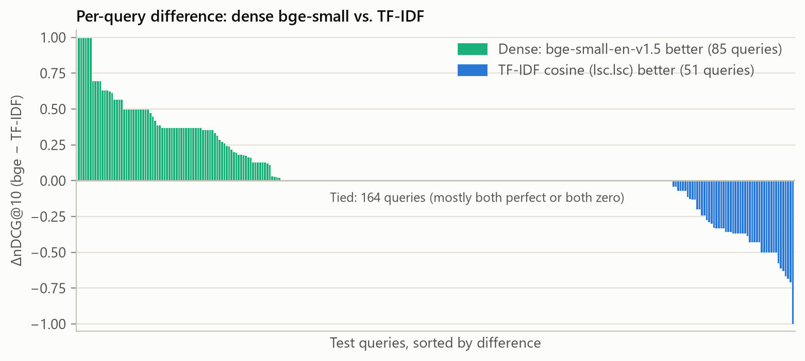
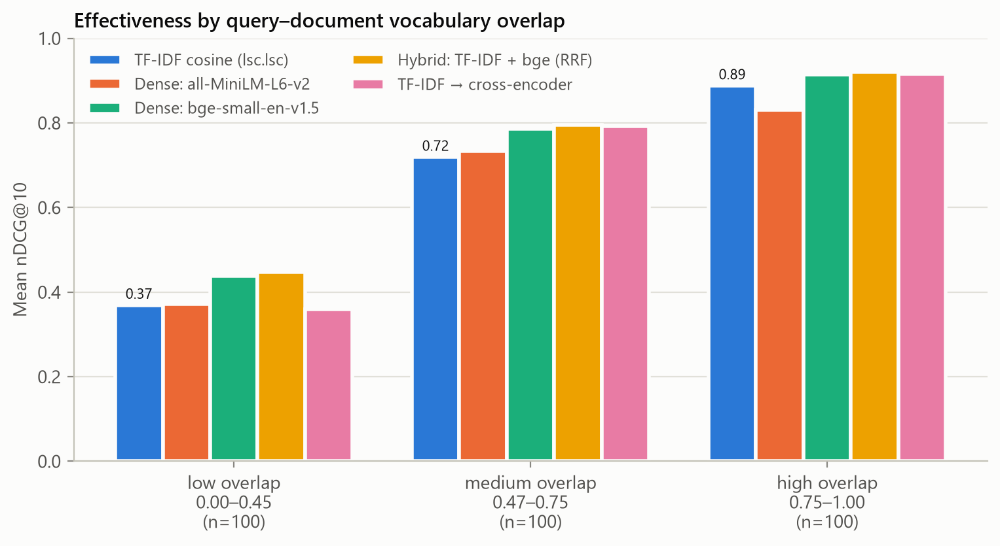

# Classical vs. Semantic Information Retrieval: TF-IDF with Cosine Similarity vs. Transformer-Based Search on BEIR SciFact

## 1. Aim

Build a classical Information Retrieval (IR) system using **TF-IDF term weighting and cosine
similarity**, then measure its retrieval effectiveness against modern **semantic search** built on
pretrained transformer language models. The questions are:

1. How good is a well-configured TF-IDF system on a realistic scientific retrieval task?
2. Do semantic methods built on transformer language models (embeddings, a cross-encoder and LLM
   rerankers) beat it, by how much, and is the gap statistically reliable?
3. *Where* does each approach win, and why?
4. What does the extra effectiveness cost in time, memory and hardware?

Every number in this report comes from the files the pipeline writes to [`results/`](results/)
(`uv run irsys evaluate && uv run irsys analyze`).

## 2. Dataset: BEIR SciFact

SciFact (Wadden et al., 2020), in its BEIR packaging (Thakur et al., 2021), pairs short scientific
**claims** (the queries) with the **research abstracts** that support or refute them.

| | |
|---|---|
| Corpus | 5,183 abstracts (title + abstract; on average 146 index terms after preprocessing) |
| Test queries | 300 claims (on average 9.2 index terms) |
| Train queries | 809 claims, disjoint from test, used **only** to choose the TF-IDF configuration |
| Relevance judgments | binary; 339 judgments over the 300 test queries (277 queries have exactly one relevant abstract) |

It is a good test bed for this comparison. Claims are written in different words from the abstracts
that answer them (for example, a claim about "silencing of Bcl2" is answered by an abstract on
"antiapoptotic BCL-2"), yet both use dense technical vocabulary that rewards exact term matching.

## 3. Methods

### 3.1 The classical system: TF-IDF + cosine similarity (built from scratch)

**Text analysis** (`src/irsys/preprocess.py`). Lowercase → split into `[a-z0-9]+` tokens (numbers are
kept, since claims often quote figures) → remove English stopwords → Porter stemming.

Two classical NLP options build on **part-of-speech (POS) tagging**. NLTK's averaged-perceptron tagger
(Bird et al., 2009) labels every token with a Penn Treebank tag (Marcus et al., 1993), with stopwords still in place so the
tagger sees the full context:

- **POS-based lemmatization** replaces stemming. Each word becomes its WordNet dictionary form for its
  part of speech (Miller, 1995): *studies* (NNS) → *study*, *increased* (VBD) → *increase*, and *meeting*
  stays *meeting* as a noun but becomes *meet* as a verb.
- **Noun-phrase chunking** (shallow parsing) runs NLTK's regular-expression chunk parser with the grammar
  `NP: {<JJ.*|NN.*>*<NN.*>}`. That is the adjective/noun-ending-in-a-noun pattern of technical terms
  (Justeson & Katz, 1995). For example, *"LDL cholesterol has no involvement in the development of
  cardiovascular disease"* is parsed as [LDL cholesterol] … [involvement] … [development] … [cardiovascular
  disease]. Each pair of adjacent words inside a phrase becomes an extra index term (`ldl_cholesterol`,
  `cardiovascular_diseas`), a POS-filtered form of biword indexing (Manning et al., 2008, §2.4.1).

Both options are evaluated in the ablation (§4.1). The demo shows every step for any claim.

**Inverted index** (`src/irsys/tfidf.py`). One postings list per term holds the documents it occurs in,
with weights pre-computed and length-normalized at index time. The SciFact index has 25,963 terms
and takes 5.1 MB.

**Weighting** uses SMART notation `ddd.qqq` (Manning et al., 2008, ch. 6): document weighting, then
query weighting, each written as *tf / idf / normalization*:

| letter | term frequency | document frequency | normalization |
|---|---|---|---|
| `n` | raw $tf$ | none (1) | none |
| `l` | $1 + \ln tf$ | — | — |
| `t` | — | $\ln \frac{N}{df}$ | — |
| `s` | — | $\ln \frac{N}{df} + 1$ (scikit-learn's variant; not an original SMART letter) | — |
| `c` | — | — | cosine (L2 length) |

For the selected scheme `lsc.lsc`, a term $t$ in a document (or the query) gets the weight

$$w_{t,d} = (1 + \ln tf_{t,d}) \cdot \left(\ln\frac{N}{df_t} + 1\right),$$

and the vectors are L2-normalized. The relevance score is then the **cosine similarity**

$$\text{score}(q,d) = \cos(\vec q, \vec d) = \sum_{t \in q \cap d} \hat w_{t,q}\,\hat w_{t,d},$$

computed term-at-a-time. Only the postings lists of the query's terms are visited, so documents that
share no term with the query are never touched and never returned.

**Correctness checks.** Unit tests compare the scores against values worked out by hand from the
formulas (`tests/test_tfidf.py`). A parity test also requires that our `lsc.lsc` scores equal
scikit-learn's `TfidfVectorizer(sublinear_tf=True, smooth_idf=False, norm="l2")` + `cosine_similarity`
to within $10^{-9}$ on every document. A mutation check confirmed that the parity test fails when the
scheme is changed.

### 3.2 Semantic search with transformer language models

| System | How it works | Model |
|---|---|---|
| **Dense: all-MiniLM-L6-v2** | Bi-encoder. Query and documents are embedded *independently* into a 384-dimensional space; relevance = cosine of the embeddings (exact search over all 5,183 vectors). | 6-layer MiniLM, 22.7M params, general-purpose sentence embeddings (Reimers & Gurevych, 2019) |
| **Dense: bge-small-en-v1.5** | Same bi-encoder approach; queries get the instruction prefix *"Represent this sentence for searching relevant passages: "* | BAAI BGE small, 33.4M params, trained specifically for retrieval (Xiao et al., 2023) |
| **TF-IDF → cross-encoder** | Two-stage. TF-IDF retrieves the top 100; a cross-encoder reads each *(query, abstract)* pair **jointly** and re-scores it (Nogueira & Cho, 2019). | `ms-marco-MiniLM-L-6-v2`, 22.7M params, trained on MS MARCO web search |
| **Hybrid: TF-IDF + bge (RRF)** | Reciprocal Rank Fusion of the TF-IDF and bge rankings: $\text{score}(d) = \sum_{r} \frac{1}{60 + \text{rank}_r(d)}$ (Cormack et al., 2009). It uses ranks only, so the different score scales never need calibrating. | none beyond its two inputs |
| **TF-IDF → LLM, zero-shot** | Two-stage. TF-IDF retrieves the top 100; a general chat LLM is *prompted* (no task training) with the claim and one abstract, and may only answer "yes" or "no". | Qwen3-0.6B, 596M params, decoder-only LLM (Qwen Team, 2025) |
| **TF-IDF → LLM reranker** | The same prompt and scoring, on the same LLM after fine-tuning for relevance judgement. | Qwen3-Reranker-0.6B, 596M params (Zhang et al., 2025) |

All models are used off the shelf; we fine-tune nothing. The bi-encoders and the cross-encoder are
compact *encoder* language models (BERT family). The two Qwen3 models are *decoder-only*, GPT-style
large language models, small enough (0.6B parameters, 1.2 GB in bfloat16) to run on a 4 GB laptop GPU.

**LLM scoring** (`src/irsys/llm.py`). Each (claim, abstract) pair becomes one chat prompt, in the format
Qwen3-Reranker was trained on, with the task instruction its authors use for SciFact:

```
<|im_start|>system
Judge whether the Document meets the requirements based on the Query and the Instruct provided.
Note that the answer can only be "yes" or "no".<|im_end|>
<|im_start|>user
<Instruct>: Given a scientific claim, retrieve documents that support or refute the claim
<Query>: {claim}
<Document>: {title + abstract}<|im_end|>
<|im_start|>assistant
<think>

</think>

```

The LLM does not generate any text. One forward pass gives its next-token logits, and the relevance
score is the log-odds $\log P(\text{yes}) / P(\text{no}) = z_\text{yes} - z_\text{no}$: pointwise relevance
judgement, as in monoT5 (Nogueira et al., 2020). Prompts are capped at 512 tokens, the same as the
cross-encoder, by cutting the end of the abstract. Running one prompt through the same-size LLM before and
after relevance fine-tuning separates what prompting alone achieves from what task training adds.

### 3.3 Experimental protocol

- **No tuning on test data.** The TF-IDF configuration is selected by nDCG@10 on the **train** queries
  (§4.1). The models, the reranking depth (100), the LLM prompt (the model authors' SciFact instruction)
  and the RRF constant ($k=60$, the published default) are fixed in advance. The 300 test queries are
  used once, for the final comparison.
- **Metrics.** Six ranking metrics, implemented from scratch with trec_eval/BEIR definitions and
  unit-tested on hand-computed cases: **nDCG@k**, **MAP**, **MRR**, **Precision@k**, **Recall@k** and
  **F1@k** (the harmonic mean of P@k and R@k), at k = 5 and 10. **nDCG@10** is the primary metric, as in
  BEIR. Every system returns the top 100 documents per query; MAP and MRR use that whole ranking.
- **Significance.** Each system is compared with TF-IDF on nDCG@10 on the *same* queries using the
  two-sided Wilcoxon signed-rank test, with a Holm correction over the 6 comparisons.
- **Speed.** Index build time and the mean time to answer one query.
- **Hardware:** NVIDIA RTX 3050 Laptop GPU (4 GB), PyTorch 2.14.1 (CUDA 13.0), Python 3.13.5.
  TF-IDF runs on the CPU.

## 4. Results

### 4.1 Choosing the TF-IDF configuration (train split, 809 queries)

From [`results/ablation_train.md`](results/ablation_train.md), which also has the k = 5 columns:

| Configuration | nDCG@10 | MAP | MRR | P@10 | R@10 | F1@10 |
|---|---:|---:|---:|---:|---:|---:|
| `ntc.ntc`, raw tokens (no stopword removal, no stemming) | 0.5957 | 0.5468 | 0.5584 | 0.0842 | 0.7559 | 0.1497 |
| `ltc.ltc` + stopwords | 0.6456 | 0.6029 | 0.6119 | 0.0875 | 0.7865 | 0.1557 |
| `ltc.ltc` + stopwords + stemming | 0.6688 | 0.6250 | 0.6347 | 0.0897 | 0.8097 | 0.1598 |
| `lnc.ltc` + stopwords + stemming | 0.6758 | 0.6343 | 0.6460 | 0.0896 | 0.8073 | 0.1595 |
| **`lsc.lsc` + stopwords + stemming (selected)** | **0.6789** | **0.6364** | **0.6468** | **0.0904** | **0.8141** | **0.1608** |
| `lsc.lsc` + stopwords + POS lemmatization | 0.6644 | 0.6206 | 0.6304 | 0.0896 | 0.8043 | 0.1594 |
| `lsc.lsc` + stopwords + stemming + noun phrases | 0.6595 | 0.6147 | 0.6229 | 0.0897 | 0.8063 | 0.1596 |
| `lsc.lsc` + stopwords + POS lemmatization + noun phrases | 0.6411 | 0.5978 | 0.6067 | 0.0875 | 0.7853 | 0.1556 |
| scikit-learn `TfidfVectorizer` reference (= `lsc.lsc`) | 0.6789 | 0.6364 | 0.6468 | 0.0904 | 0.8141 | 0.1608 |

The selected configuration is the best on all six metrics, at k = 10 and at k = 5.

- **Sublinear tf + stopword removal** gives the largest gain (+0.050 nDCG@10 over raw counts). One
  repeated term can no longer dominate a document, and function words stop adding noise.
- **Porter stemming** adds +0.023, by matching *mutation/mutations/mutated*.
- The `lnc`/`ltc`/`lsc` variants with stemming are within about 0.01 of each other. idf is the only thing
  they change: none on documents (`lnc`), or the "+1" variant that keeps common terms from dropping to
  zero weight (`lsc`).
- **POS-based lemmatization is worse than stemming** (−0.015). Lemmatization is the more conservative
  normalizer: the corpus has 35,450 distinct surface words, 32,017 lemmas but only 25,963 stems. Stemming
  maps *activate, activation, active* all to `activ`, and *indicate, indication, indicator* to `indic`,
  while lemmatization keeps the verb and the noun apart. Claims and abstracts often state the same fact
  with a different form of the word (claim *discontinue* / abstract *discontinuation*; *positivity* /
  *positive*). On the training claims, stems match more of a claim's terms in its relevant abstract than
  lemmas do for **228** of the 809 claims, and fewer for only 27. That extra matching outweighs stemming's
  over-merging (*organ/organism/organization* → `organ`).
- **Noun-phrase terms lower nDCG@10 (−0.019)**, and every other metric with it. Phrases are very
  specific: 36% of the claims' phrase terms occur in no abstract, and the rest are rare (median document
  frequency 6). Their large idf lets one exact shared phrase dominate the score, which often promotes the
  wrong abstract to the top. Combining both options is the worst of the POS variants (0.641).
- The selection rule (best nDCG@10 on train) therefore keeps plain stemming. POS tagging and chunking stay
  in the system as analysis tools: the demo shows the tags and phrases for any claim.
- The scikit-learn reference reproduces our `lsc.lsc` system exactly, which cross-checks the whole
  pipeline end to end.

### 4.2 Main comparison (test split, 300 queries)

From [`results/metrics.md`](results/metrics.md). At k = 10, with MAP and MRR over each system's top 100:

| System | nDCG@10 | MAP | MRR | P@10 | R@10 | F1@10 |
|---|---:|---:|---:|---:|---:|---:|
| **TF-IDF cosine** (`lsc.lsc`) | 0.659 | 0.609 | 0.623 | 0.090 | 0.819 | 0.160 |
| Dense: all-MiniLM-L6-v2 | 0.645 | 0.603 | 0.611 | 0.088 | 0.783 | 0.156 |
| Dense: bge-small-en-v1.5 | 0.713 | 0.674 | 0.687 | 0.094 | 0.836 | 0.167 |
| Hybrid: TF-IDF + bge (RRF) | 0.721 | 0.674 | 0.686 | 0.098 | 0.872 | 0.173 |
| TF-IDF → cross-encoder | 0.690 | 0.652 | 0.666 | 0.091 | 0.811 | 0.161 |
| TF-IDF → LLM zero-shot (Qwen3-0.6B) | 0.276 | 0.239 | 0.246 | 0.049 | 0.443 | 0.087 |
| **TF-IDF → LLM reranker (Qwen3-Reranker-0.6B)** | **0.772** | **0.734** | **0.743** | **0.100** | **0.889** | **0.177** |

At k = 5:

| System | nDCG@5 | P@5 | R@5 | F1@5 |
|---|---:|---:|---:|---:|
| **TF-IDF cosine** (`lsc.lsc`) | 0.633 | 0.161 | 0.745 | 0.260 |
| Dense: all-MiniLM-L6-v2 | 0.629 | 0.164 | 0.738 | 0.263 |
| Dense: bge-small-en-v1.5 | 0.685 | 0.167 | 0.759 | 0.269 |
| Hybrid: TF-IDF + bge (RRF) | 0.692 | 0.173 | 0.787 | 0.279 |
| TF-IDF → cross-encoder | 0.668 | 0.165 | 0.748 | 0.265 |
| TF-IDF → LLM zero-shot (Qwen3-0.6B) | 0.235 | 0.069 | 0.324 | 0.113 |
| **TF-IDF → LLM reranker (Qwen3-Reranker-0.6B)** | **0.744** | **0.180** | **0.808** | **0.288** |



- **The fine-tuned LLM reranker is the best system on all six metrics, at both k = 5 and k = 10.** The
  *same* LLM used zero-shot is by far the worst system, at less than half of TF-IDF's nDCG@10 (§5.4
  explains why).
- **The order of the systems is the same on almost every metric.** The one exception: general-purpose
  MiniLM edges TF-IDF on P@5 and F1@5 (0.164 vs. 0.161), but is behind it on every other metric.
- **Precision@k and F1@k are small for every system** because most queries have only one relevant
  abstract, which caps P@5 at 0.2 and P@10 at 0.1. F1@k sits close to the smaller of the two, precision.
  Going from k = 5 to k = 10, recall rises (TF-IDF 0.745 → 0.819, LLM reranker 0.808 → 0.889) while
  precision halves.
- **Beyond the top 10:** TF-IDF's top 100 contains none of the relevant abstracts for 20 of the 300
  queries, the hybrid's for only 9. The hybrid rescues 11 of TF-IDF's 20 and loses none.

The other results agree with published numbers.
- The dense models reproduce the SciFact nDCG@10 that an independent BEIR evaluation reports for the
  same checkpoints: 0.713 for bge-small-en-v1.5 and 0.645 for all-MiniLM-L6-v2 (mxbai-edge-colbert-v0
  tech report, Table 16).
- The cross-encoder's +0.031 over TF-IDF is close to the gain the BEIR paper (Table 2) reports for the
  same reranker on top of BM25: 0.665 → 0.688, i.e. +0.023.

### 4.3 Statistical significance (vs. TF-IDF)

From [`results/significance.md`](results/significance.md). W/T/L counts the queries where the system
does better / the same / worse than TF-IDF.

| System | Δ nDCG@10 | W/T/L | Wilcoxon p | Holm-adjusted p | Significant? |
|---|---:|:---:|---:|---:|:---:|
| Dense: all-MiniLM-L6-v2 | −0.014 | 72/161/67 | 0.36 | 0.36 | no |
| Dense: bge-small-en-v1.5 | +0.054 | 85/164/51 | 0.0027 | 0.0082 | **yes** |
| Hybrid: TF-IDF + bge (RRF) | +0.063 | 83/184/33 | 3.7 × 10⁻⁸ | 1.5 × 10⁻⁷ | **yes** |
| TF-IDF → cross-encoder | +0.031 | 74/171/55 | 0.043 | 0.086 | no (after correction) |
| TF-IDF → LLM zero-shot (Qwen3-0.6B) | −0.383 | 9/86/205 | 5.2 × 10⁻³³ | 3.1 × 10⁻³² | **yes (worse)** |
| TF-IDF → LLM reranker (Qwen3-Reranker-0.6B) | +0.113 | 96/171/33 | 1.0 × 10⁻¹¹ | 5.1 × 10⁻¹¹ | **yes** |

The LLM reranker's lead holds against the strongest other systems too. These are three further paired
Wilcoxon tests, run after seeing the results and so outside the corrected family above; all three would
survive a Holm correction:

| LLM reranker vs. | Δ nDCG@10 | W/T/L | Wilcoxon p |
|---|---:|:---:|---:|
| Hybrid: TF-IDF + bge (RRF) | +0.051 | 73/195/32 | 2.3 × 10⁻⁵ |
| Dense: bge-small-en-v1.5 | +0.059 | 69/197/34 | 2.5 × 10⁻⁵ |
| TF-IDF → cross-encoder (same 100 candidates) | +0.083 | 78/189/33 | 1.5 × 10⁻⁷ |

### 4.4 Efficiency

From [`results/efficiency.md`](results/efficiency.md) (time per query = one query at a time, top 100):

| System | Index build | Time per query | Hardware |
|---|---:|---:|:---:|
| TF-IDF cosine | 1.0 s | **0.17 ms** | CPU |
| Dense: all-MiniLM-L6-v2 | 13.0 s | 7.9 ms | GPU |
| Dense: bge-small-en-v1.5 | 47.3 s | 12.5 ms | GPU |
| Hybrid: TF-IDF + bge | 48.3 s | 14.5 ms | GPU |
| TF-IDF → cross-encoder | 1.0 s | 484 ms | GPU |
| TF-IDF → LLM zero-shot | 1.0 s | 5,729 ms | GPU |
| TF-IDF → LLM reranker | 1.0 s | 5,789 ms | GPU |

TF-IDF answers a query about **70× faster than bge-small, ~2,800× faster than cross-encoder reranking
and ~34,000× faster than LLM reranking**. It needs no GPU, no model download and about a second to index.
The rerankers are expensive because they run a full transformer forward pass for each of the 100
candidates per query; the LLM has 26× the cross-encoder's parameters and takes 12× as long. Each LLM run
over the 300 test queries took about 29 minutes on the laptop GPU.

## 5. Analysis: where does each approach win?

### 5.1 Per-query differences



The average hides a lot of disagreement between the systems. bge-small beats TF-IDF on 85 queries,
**TF-IDF beats bge-small on 51**, and 164 are tied. 154 of those ties are queries where both systems are
perfect (129) or both score zero (25). The two methods fail on largely *different* queries: TF-IDF scores
zero on 48 queries and bge on 46, but only 25 of these are shared. That complementarity is why fusing
them works. The hybrid scores zero on only 34 queries, and its top 100 never loses a relevant abstract
that TF-IDF's top 100 contained. The LLM reranker scores
zero on 31. It rescues 24 of TF-IDF's 48 failures and loses only 7 queries that TF-IDF had found.

### 5.2 Vocabulary mismatch

The usual argument for semantic search is the **vocabulary-mismatch problem**: a relevant document may
use different words from the query, and term matching cannot bridge that gap. To test this directly,
each test query gets a **lexical overlap** score: the share of its index terms (after stopword removal
and stemming) that appear in its relevant abstract(s). The queries are then split into three equal
groups (from [`results/overlap_buckets.md`](results/overlap_buckets.md)):

| Overlap tercile | Overlap range | TF-IDF | MiniLM | bge-small | Hybrid | → CE | → LLM zero-shot | → LLM reranker |
|---|:---:|---:|---:|---:|---:|---:|---:|---:|
| low | 0.00–0.45 | 0.369 | 0.371 | 0.438 | 0.448 | 0.360 | 0.110 | **0.530** |
| medium | 0.47–0.75 | 0.719 | 0.733 | 0.785 | 0.796 | 0.792 | 0.292 | **0.835** |
| high | 0.75–1.00 | 0.888 | 0.831 | 0.914 | 0.921 | 0.917 | 0.424 | **0.951** |

(→ = reranking TF-IDF's top 100.)



- **Every** system degrades as overlap falls. Even the neural models do much better when the
  vocabularies agree, and all of them find the low-overlap third hard.
- TF-IDF depends on overlap the most: its nDCG@10 climbs by 0.52 from the low to the high tercile, against
  0.48 for bge, 0.46 for MiniLM and 0.42 for the LLM reranker. Only the cross-encoder, which inherits
  TF-IDF's candidates, climbs more (0.56).
- bge's advantage over TF-IDF is largest when overlap is low or medium (+0.069, +0.066) and shrinks to
  +0.026 when overlap is high. With high overlap, TF-IDF (0.888) clearly beats the general-purpose MiniLM
  (0.831).
- The cross-encoder helps a lot in the medium tercile (+0.073) but **not** in the low one (0.360 vs. 0.369).
  A reranker cannot recover a document that the first stage never retrieved: on 20 queries none of the
  relevant abstracts is in TF-IDF's top 100. In this setup TF-IDF's recall is the ceiling.
- The LLM reranker is the best system in every tercile, and its gain over TF-IDF is largest exactly where
  TF-IDF is weakest: +0.161 at low overlap, +0.116 at medium, +0.063 at high. Unlike the cross-encoder, it
  *does* lift the low-overlap claims whose relevant abstract is somewhere in the 100 candidates: it
  recognises a relevant abstract that shares few words with the claim, even though TF-IDF put it low.

### 5.3 Illustrative queries

Selected from [`results/examples.md`](results/examples.md):

**Semantic search wins — morphology and tokenization.**
*"Silencing of Bcl2 is important for the maintenance and progression of tumors."*
The relevant abstract is titled *"Antiapoptotic **BCL-2** is required for maintenance of a model
leukemia"*. The tokenizer turns "BCL-2" into `bcl` + `2`, while the claim's "Bcl2" becomes `bcl2`, so the
gene name, the most informative word in the claim, never matches. TF-IDF ranks the abstract **32nd**.
Its top hit is a different paper that spells "Bcl2" the same way the claim does. Both dense models rank
the right abstract **1st**, because their subword tokenizers and learned representations treat *Bcl2*,
*BCL-2* and *antiapoptotic* as related. The LLM reranker, reading TF-IDF's 100 candidates, also puts it
1st.

**Semantic search wins — paraphrase.**
*"The treatment of cancer patients with co-IR blockade does not cause any adverse autoimmune events."*
The relevant abstract is *"Is autoimmunity the Achilles' heel of cancer immunotherapy?"*. The claim and
the abstract describe the same idea in different words. TF-IDF ranks it 11th; both dense models and the
LLM reranker rank it 1st, while the cross-encoder leaves it 12th.

**TF-IDF wins — a rare, exact technical term.**
*"Ivermectin is used to treat onchocerciasis."*
Only one of the claim's four index terms appears in the relevant abstract (*ivermectin* is not in the
corpus at all). But that term, *onchocerciasis*, occurs in exactly **one** of the 5,183 abstracts, so it
gets the maximum possible idf, and TF-IDF ranks the abstract **1st**. bge-small ranks it 59th and MiniLM
not in its top 100. bge's top hit is an abstract about antihypertensive drug therapy. A likely
explanation is that the dense models have only a vague representation of such a rare disease name and
fall back on the general "drug treatment" meaning of the claim. This is the classic strength of exact
matching: rare, precise terms such as gene, drug and disease names. The cross-encoder moves the abstract
down to 57th; the LLM reranker, which reads the full abstract, keeps it 1st.

**TF-IDF wins — high overlap, subtle topic.**
*"LDL cholesterol has no involvement in the development of cardiovascular disease."*
Five of six query terms occur in the relevant abstract (a genome-wide association study of LDL
cholesterol), and TF-IDF ranks it 1st. bge ranks it 10th, preferring a review of *HDL* cholesterol and
statin treatment. This is topically close, but the dense embedding blurs the precise LDL/HDL
distinction that exact term matching keeps. The LLM reranker keeps it 1st as well.

In all four examples the fine-tuned LLM reranker ranks the relevant abstract 1st. The zero-shot LLM
ranks it 7th, 30th, 51st and 28th.

### 5.4 Error analysis

From [`results/error_analysis.md`](results/error_analysis.md). A claim **fails** for a system when none of
its relevant abstracts is in the top 10 (nDCG@10 = 0). To ask *why* systems fail, each claim is put in
one category using only the claim and its relevant abstract(s), so the categories are the same for
every system. The rules apply in order:

1. **spelling variant**: a claim word is written differently in the abstract (*Bcl2* / *BCL-2*,
   *birth weight* / *birthweight*);
2. **vocabulary mismatch**: fewer than half of the claim's index terms occur in the abstract;
3. **rare shared term**: a shared term occurs in at most 10 of the 5,183 abstracts;
4. **common words only**: everything else.

| Category | Claims | TF-IDF | MiniLM | bge | Hybrid | → CE | → LLM zero-shot | → LLM reranker |
|---|---:|---:|---:|---:|---:|---:|---:|---:|
| spelling variant | 15 | 2 (13%) | 0 | 0 | 0 | 0 | 4 (27%) | 0 |
| vocabulary mismatch | 99 | 34 (34%) | 47 (47%) | 38 (38%) | 31 (31%) | 43 (43%) | 76 (77%) | 27 (27%) |
| rare shared term | 106 | **0 (0%)** | 6 (6%) | 1 (1%) | 0 | 3 (3%) | 35 (33%) | 1 (1%) |
| common words only | 80 | 12 (15%) | 9 (11%) | 7 (9%) | 3 (4%) | 6 (8%) | 44 (55%) | 3 (4%) |
| **all claims** | 300 | 48 (16%) | 62 (21%) | 46 (15%) | 34 (11%) | 52 (17%) | 159 (53%) | 31 (10%) |

- **Vocabulary mismatch is the hard core of the task.** A third of the claims fall in it, and it holds
  most failures of *every* system, the LLM reranker included (27 of its 31). Neural models reduce the
  problem; they do not remove it.
- **Rare shared terms are TF-IDF's home ground.** In the 106 claims that share a rare term with their
  relevant abstract, TF-IDF never fails, while MiniLM fails 6 times and the cross-encoder 3 times.
- **Spelling variants are the one category where TF-IDF fails and every neural model succeeds** (2 of 15
  claims, e.g. *Bcl2*). Subword tokenizers make the neural models robust to hyphenation.
- **"Common words only"** claims (all shared terms appear in more than 10 abstracts) are where combining
  signals pays most: the hybrid and the LLM reranker fail on 4%, TF-IDF on 15%.

**Reranker failures: first stage or reranker?** A reranker failure is either a relevant abstract that
TF-IDF never retrieved, which no reranker can fix, or one the reranker saw but ranked below 10:

| Reranker | Failures | TF-IDF never retrieved it | Reranker ranked it low |
|---|---:|---:|---:|
| Cross-encoder | 52 | 20 | 32 |
| LLM zero-shot | 159 | 20 | 139 |
| LLM reranker | 31 | 20 | **11** |

Two thirds of the LLM reranker's failures (20 of 31) are first-stage misses. It almost never misjudges an
abstract it is shown. The obvious next step is a stronger first stage, such as the hybrid, whose top 100
misses the relevant abstract on only 9 queries against TF-IDF's 20.

**Why the zero-shot LLM fails.** The share of TF-IDF candidates each LLM answered "yes" to (P(yes) > 0.5),
out of 29,889 judged (claim, abstract) pairs, where roughly 1 candidate in 100 is relevant:

| LLM | Answered "yes" to all candidates | … to the relevant candidates |
|---|---:|---:|
| Qwen3-0.6B, zero-shot | **100.0%** | 100.0% |
| Qwen3-Reranker-0.6B (fine-tuned) | 2.3% | 75.0% |

The general model says "yes" to **every** abstract. Its ranking therefore rests on small differences in
an always-high confidence, which carry little information about relevance. The result is worse than
simply keeping TF-IDF's order: it beats TF-IDF on only 9 claims and loses on 205. Fine-tuned on
relevance judgements, the *same* architecture is well calibrated. It says "yes" to 2.3% of candidates,
close to the true rate of about 1%, and to three quarters of the relevant ones. A 0.6B-parameter model
does not follow the instruction "answer yes or no" discriminatively from prompting alone; task training
supplies that.

## 6. Discussion

**How good is TF-IDF?** Very competitive. With sensible preprocessing it reaches nDCG@10 = 0.659. That
beats a popular general-purpose embedding model (MiniLM, 0.645; the difference is not significant) and
lands within 0.01 of BEIR's published BM25 figure for SciFact (0.665). Scientific claims and abstracts
share a lot of rare, precise vocabulary, which is exactly what idf weighting rewards.

**Does semantic search beat it?** A retrieval-trained model does, by a clear and statistically significant
margin: bge-small +0.054 nDCG@10 (+8%), with gains concentrated on queries phrased differently from their
answers. A *general-purpose* sentence embedding (MiniLM) does not. The training objective matters more
than "neural vs. classical". Cross-encoder reranking adds +0.031, but it is limited by what TF-IDF
retrieves and is not significant after correction.

**Does an LLM beat it?** It depends entirely on how the LLM is used. Fine-tuned for relevance judgement,
a 0.6B-parameter LLM reranking TF-IDF's top 100 is the best system in the study: nDCG@10 0.772, +0.113
(+17%) over TF-IDF. It is significantly better than every other system, including the hybrid and the
cross-encoder, which reorders exactly the same candidates. Used zero-shot, the *same* model is the
worst system by far (0.276), because it answers "yes" to every abstract (§5.4). This mirrors the MiniLM/bge
contrast at a larger scale: what makes a model good at retrieval is training on the retrieval task,
not its size or architecture.

**Best of both worlds.** The approaches fail on different queries (§5.1), so combining them beats each
alone. The two combinations in the study do different jobs. The hybrid is the best *first stage*: its
top 100 misses the relevant abstract on only 9 queries (TF-IDF: 20) and never loses one TF-IDF had
found, with no weights to tune. The LLM reranker is the best *final ranking*, but two thirds of its failures are relevant
abstracts TF-IDF never retrieved. A hybrid first stage with an LLM reranker on top is therefore the
natural next design. It is the standard architecture of modern search systems: cheap retrieval of
candidates, then an expensive model on a short list.

**At what cost?** TF-IDF is about 70× faster than dense search, ~2,800× faster than cross-encoder
reranking and ~34,000× faster than LLM reranking (0.17 ms vs. 5.8 s per query). It runs on any CPU,
indexes in about a second, and its scores can be explained term by term. The neural systems need a GPU
(or much more time) and model downloads, and dense retrieval must re-encode the corpus when it changes.
Their scores are opaque. The LLM's yes-probability reads like an explanation, but it says nothing about
*why*.

| Prefer TF-IDF when | Prefer semantic search when |
|---|---|
| queries use the corpus's own technical terms (names, codes, rare entities) | queries paraphrase or use different vocabulary from the documents |
| low latency / CPU-only / large corpora matter | effectiveness matters more than compute cost |
| results must be explainable (which terms matched) | users write natural-language questions |
| no suitable pretrained model exists for the domain or language | a retrieval-trained model exists for the domain |

## 7. Limitations

- **One dataset.** SciFact is scientific and small (5k documents). The balance could shift on other
  domains, for example conversational queries or long documents.
- **Truncation.** The bi-encoders read at most 256 (MiniLM) or 512 (bge) tokens per document, and the
  cross-encoder and the LLMs 512 tokens per prompt, so the ends of long abstracts are ignored. TF-IDF sees
  the whole text.
- **Sparse judgments.** Most queries have one relevant abstract, so a single rank change moves a query's
  score a lot, and unjudged-but-relevant documents count as misses. It is also why Precision@k and F1@k are
  low for every system.
- **Tie-splitting.** The overlap terciles break ties in query order to keep the groups equal in size, so
  0.75 appears in two buckets.
- **Model scale.** Only models up to 0.6B parameters fit the 4 GB laptop GPU. Larger LLMs, or API models,
  would likely score higher, and a larger general LLM might work zero-shot where the 0.6B one fails, at a
  much greater computational cost.
- **One prompt.** The LLMs use the instruction their authors use for SciFact. It was fixed in advance and
  not tuned (tuning it on the test claims would not be fair); other prompts could help the zero-shot model.
- **Reranking depth.** All rerankers see only TF-IDF's top 100, so they can never find a relevant abstract
  TF-IDF missed (20 of the 300 queries).
- **Efficiency numbers** come from one laptop and include Python overhead; they are only meant as
  relative comparisons.

## 8. Conclusion

A from-scratch TF-IDF/cosine system with sublinear tf, idf weighting, stopword removal and stemming is
a strong, fast and transparent baseline on scientific claim retrieval (nDCG@10 = 0.659). POS tagging and
noun-phrase chunking, tested as lemmatization and phrase indexing, did not improve on plain stemming.
A retrieval-trained semantic model (bge-small) is significantly more effective (0.713), mainly because
it copes with vocabulary mismatch. TF-IDF still wins on queries that hinge on rare, exact terms: it never
fails when a claim shares a rare term with its answer. The general-purpose MiniLM model does not beat it
at all. An LLM fine-tuned for relevance, reranking TF-IDF's candidates, is the most effective system
(0.772), while the same LLM used zero-shot is the least (0.276): task training, not model type, decides
the outcome: it is the best system on all six metrics (nDCG@k, MAP, MRR, Precision@k, Recall@k, F1@k)
at both k = 5 and 10. The best results come from **combining** classical and neural methods. The hybrid
is the best first stage, and TF-IDF retrieval followed by LLM reranking gives the best ranking.
The classical method remains thousands of times cheaper.

## 9. Reproducing the results

```sh
uv sync
uv run pytest                 # 133 tests (12 marked slow: data download + real models)
uv run irsys evaluate         # → results/*.md, *.csv, runs/*.trec, config.json  (~1 h on an RTX 3050)
uv run irsys rescore          # recompute the metric files from the saved runs (no models)
uv run irsys analyze          # → results/figures/*.png, overlap_buckets.md, error_analysis.md, examples.md
uv run irsys search "your claim here" -k 5
uv run irsys demo             # interactive demo (DEMO.md)
```

The selected TF-IDF configuration, model names, device and library versions are recorded in
[`results/config.json`](results/config.json). Ranked runs for every system are in TREC format in
[`results/runs/`](results/runs/), ready for `trec_eval`.

## References

- Bird, S., Klein, E., & Loper, E. (2009). *Natural Language Processing with Python* (NLTK). O'Reilly.
- Cormack, G. V., Clarke, C. L. A., & Büttcher, S. (2009). Reciprocal rank fusion outperforms Condorcet and individual rank learning methods. *SIGIR*.
- *Fantastic (small) Retrievers and How to Train Them: mxbai-edge-colbert-v0 Tech Report* (2025). *arXiv:2510.14880* (BEIR appendix, Table 16: reference SciFact nDCG@10 for bge-small-en-v1.5 and all-MiniLM-L6-v2).
- Justeson, J. S., & Katz, S. M. (1995). Technical terminology: some linguistic properties and an algorithm for identification in text. *Natural Language Engineering*, 1(1), 9–27.
- Manning, C. D., Raghavan, P., & Schütze, H. (2008). *Introduction to Information Retrieval*, §2.4.1 (biword indexes) and ch. 6 (Scoring, term weighting and the vector space model). Cambridge University Press.
- Marcus, M. P., Santorini, B., & Marcinkiewicz, M. A. (1993). Building a large annotated corpus of English: The Penn Treebank. *Computational Linguistics*, 19(2), 313–330.
- Miller, G. A. (1995). WordNet: A lexical database for English. *Communications of the ACM*, 38(11), 39–41.
- Nogueira, R., & Cho, K. (2019). Passage re-ranking with BERT. *arXiv:1901.04085*.
- Nogueira, R., Jiang, Z., Pradeep, R., & Lin, J. (2020). Document ranking with a pretrained sequence-to-sequence model. *Findings of EMNLP*.
- Qwen Team (2025). Qwen3 technical report. *arXiv:2505.09388*.
- Reimers, N., & Gurevych, I. (2019). Sentence-BERT: Sentence embeddings using Siamese BERT-networks. *EMNLP*.
- Salton, G., & Buckley, C. (1988). Term-weighting approaches in automatic text retrieval. *Information Processing & Management*, 24(5).
- Thakur, N., Reimers, N., Rücklé, A., Srivastava, A., & Gurevych, I. (2021). BEIR: A heterogeneous benchmark for zero-shot evaluation of information retrieval models. *NeurIPS Datasets and Benchmarks*.
- Wadden, D., Lin, S., Lo, K., Wang, L. L., van Zuylen, M., Cohan, A., & Hajishirzi, H. (2020). Fact or fiction: Verifying scientific claims. *EMNLP*.
- Xiao, S., Liu, Z., Zhang, P., & Muennighoff, N. (2023). C-Pack: Packaged resources to advance general Chinese embedding (BGE). *arXiv:2309.07597*.
- Zhang, Y., Li, M., Long, D., et al. (2025). Qwen3 Embedding: Advancing text embedding and reranking through foundation models. *arXiv:2506.05176*.
